# FunUI (formerly FunPack)

**Welcome to FunUI repository - an open-source video generation and editing studio based on ComfyUI backend.**

  &nbsp;
  &nbsp;
  

> [!IMPORTANT]
> Despite extensive multi-round testing and reviewing the code with AI agents and personally, some issues and/or undiscovered bugs still may remain in stable releases.
> If you discover a bug or wish to suggest a new feature, please open a new issue in this repo's Issues.

> [!NOTE]
> "ComfyUI-FunPack" on Comfy Registry and FunUI on GitHub is the same app.

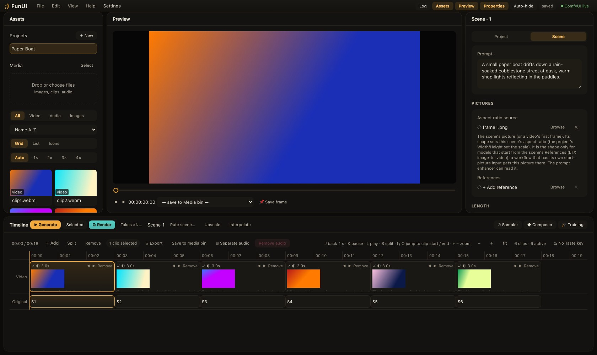

## What's FunUI?

The main idea behind FunUI is gathering as many useful features as possible inside one app, while offering a thought-out interface designed for maximum speed of daily operation.

How does it do it?

- **Timeline:** add videos, audio, pictures, effects and text. Crop, split, move and render.
- **Media bin:** upload media, select and clear aspect ratio sources and references/starting images in one click.
- **Prompt management:** build your shortcuts (keywords that expand into full sentences and act like wildcards), use variables (type $variable_name in the prompt and it's replaced with its value), prepend and append text to each scene's prompt with Prefix and Postfix, and split scenes on timeline automatically with Cut words in your prompt.
- **Projects:** switch between different pipelines in one click.
- **Presets:** you don't have to wire all nodes manually - built-in presets save you time on generic tasks.
- **Controls:** fast access to sampler settings, project settings and customizable picker wheel - what's most used is most accessible.
- **Features:** lots of operations such as upscaling, interpolation, inference speedup techniques, mixed precision - already built-in or can be activated and installed from Settings > Modules. For example, the faster attention method Veda is one switch there, and its model file is fetched from Settings > Models on your click.
- **Designed to tend to your taste:** rate resulting videos and compatible features will react according to your ratings, gradually changing outputs according to your preferences.

FunUI opens at `ComfyUI's host:port/fun/` in your browser after you start ComfyUI, e.g. `127.0.0.1:8888/fun` (the port depends on how you start ComfyUI).

## A look around

Every picture below is the real app, shown with an abstract demo project (clips made with ffmpeg, no model output).

### Write the story once

Composer holds the whole story in one box. A cut word splits it into scenes, `$variables` fill in what repeats, and templates and shortcuts keep your own wording close. The optional Enhance tab has a language model polish each prompt.

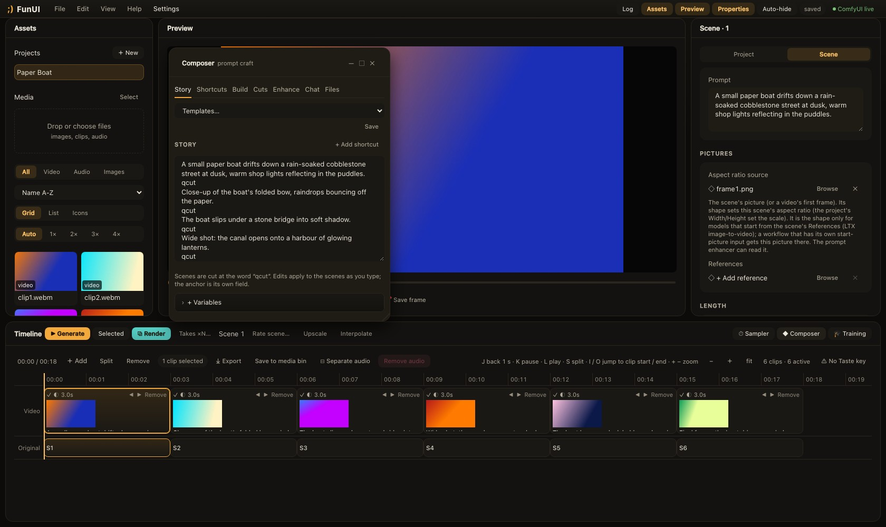

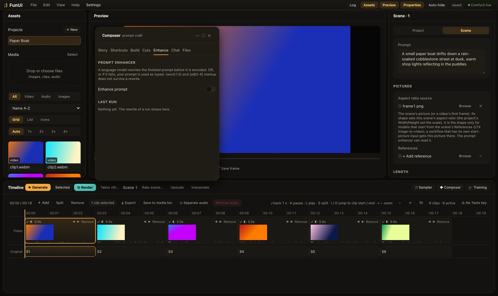

### Start a project in three steps

The Project Setup Wizard picks your look, names the project and loads the pipeline of the model you will use. No tabs, one step at a time.

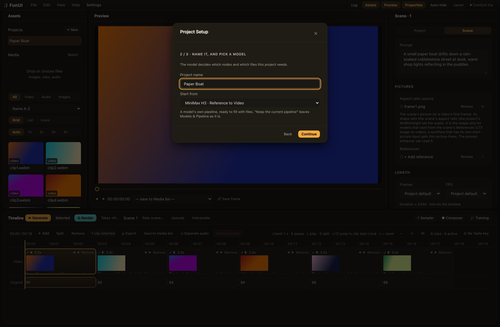

### Pipeline as cards, not a graph

Pick a file in each card, swap or add nodes, import a ComfyUI workflow. FunUI says when every slot is filled and names the first thing missing when it is not.

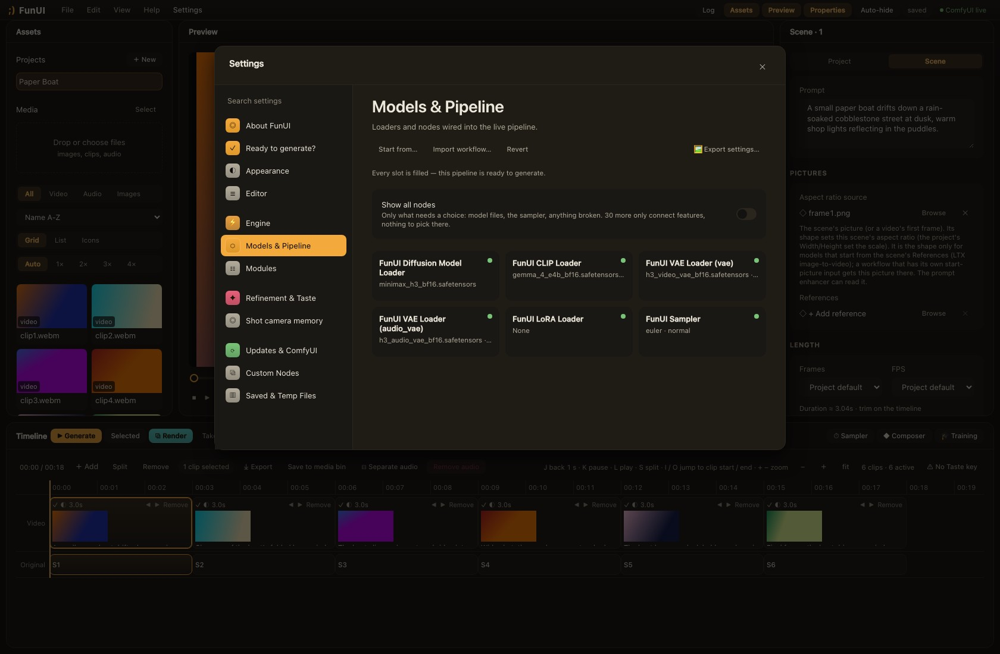

### Every module, one place

Modules announce their own settings, so Engine settings is always complete. Turn any module on or off in Settings > Modules.

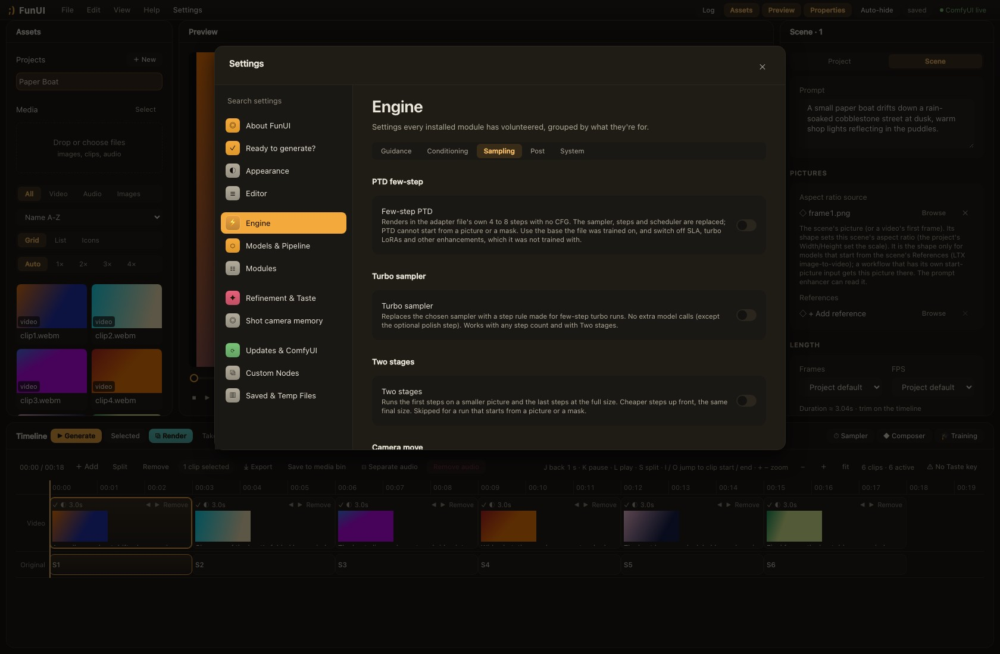

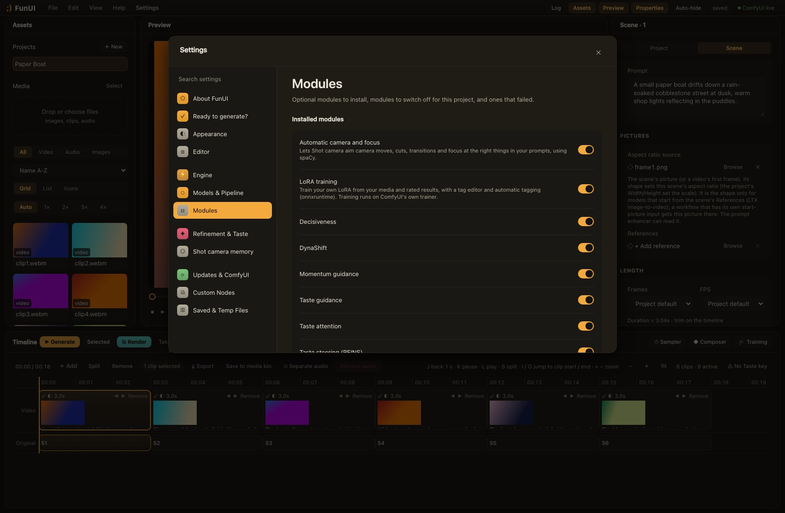

### Quick sampler settings

Steps, sampler, scheduler, seed and the common switches are one click away from the timeline, without leaving the clip you are working on.

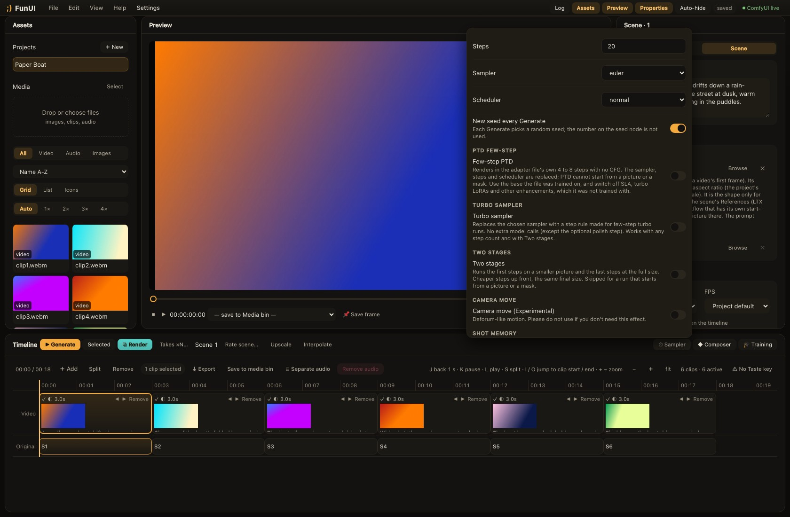

### Picker wheel

Press the middle mouse button anywhere and your most used actions fan out under the pointer. Release on one to run it. Which actions appear is up to you.

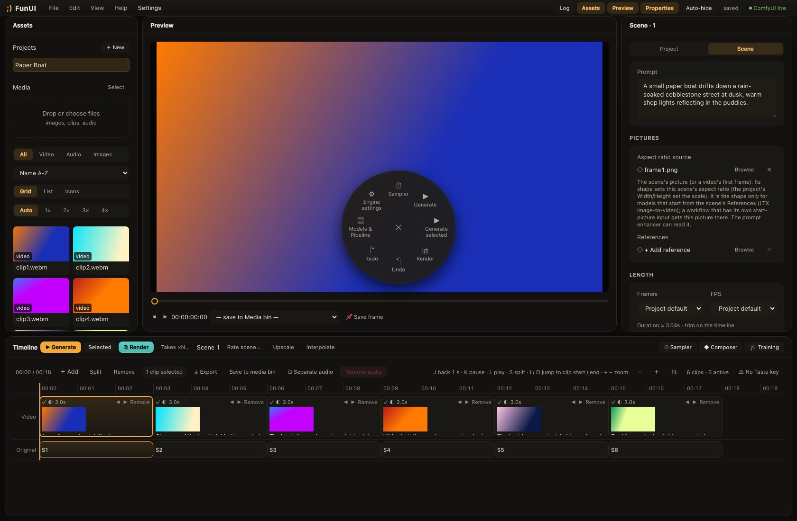

### Train your own LoRA (add-on)

Teach the model your style from your own media and results you rated. Pick the data, describe each item, press Start. It is an add-on you switch on in Settings > Modules, and it has been run on MiniMax H3 only.

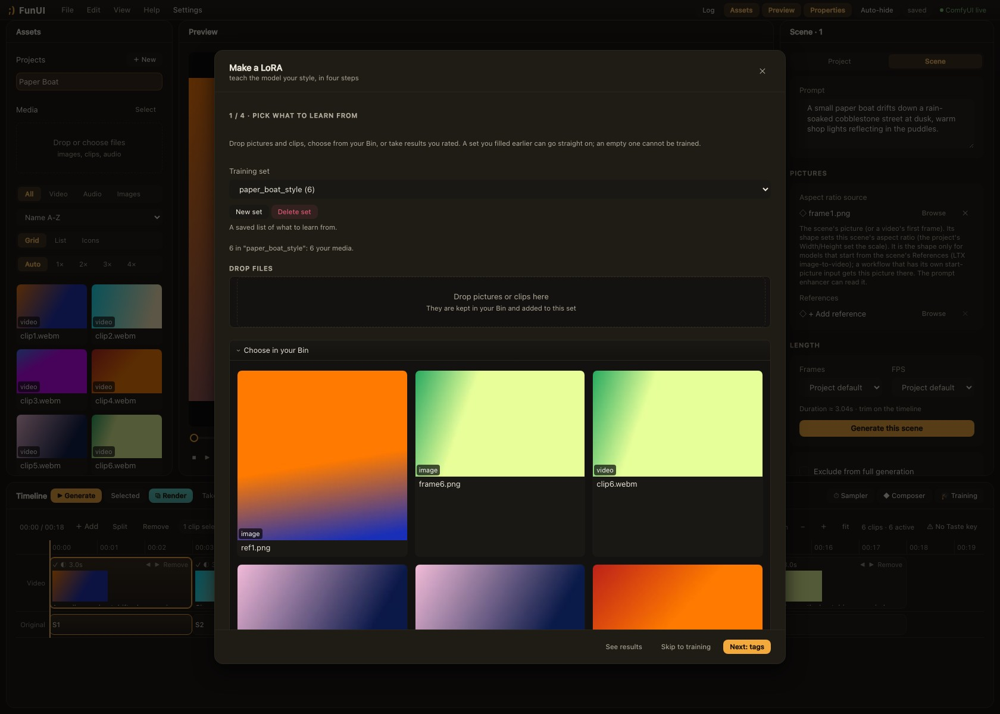

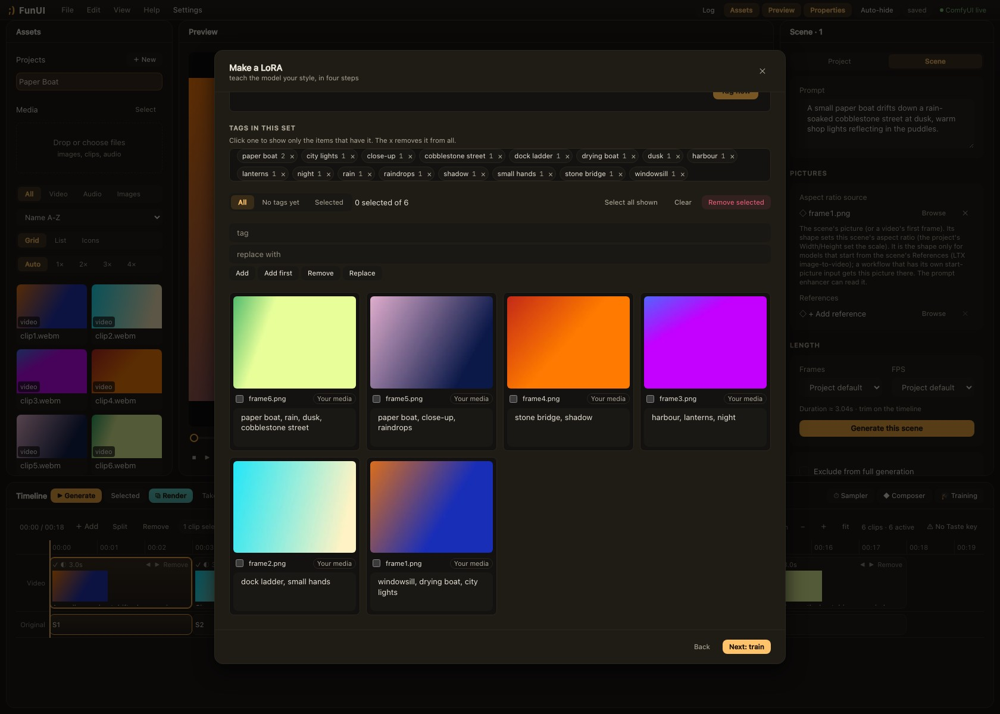

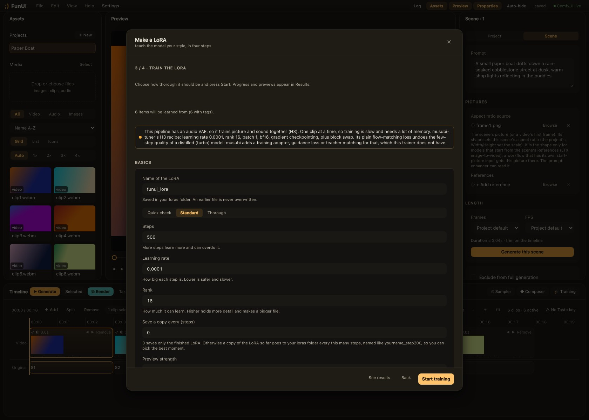

### Dark or light

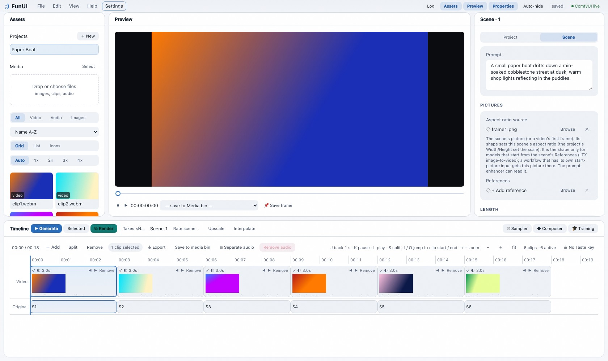

## Installation

With git, inside your `ComfyUI/custom_nodes` directory:

`git clone https://github.com/digital-garbage/FunUI && cd FunUI && pip install -r requirements.txt`

`comfy-cli` (`comfy node install ComfyUI-FunPack`) and ComfyUI-Manager install ComfyUI-FunPack from Comfy Registry. Check Settings > About FunUI after installing to see which version you have.

## Dependencies

FunUI uses your existing ComfyUI/PyTorch install. Optional dependencies install automatically when you install it from ComfyUI-Manager or comfy-cli, or can be manually installed from terminal: `pip install -r requirements.txt` inside FunUI folder.

## Models

Manually tested on Hailuo MiniMax-H3, Lightricks LTX2.3, Lightricks LTX 2.5 and Stable Diffusion 1.5. Running other models using built-in modules is possible but not guaranteed.

## Documentation

Start with [How to start generating with FunUI](docs/how-to-start.md). The app also has a guided tour: Help -> Start tour.

Writing a module or a UI feature? Start with [Developing FunUI](docs/README.md).

Version history is available in [CHANGELOG.md](CHANGELOG.md).

## Feedback

If you have suggestions, questions, or ideas for new features, feel free to open an issue or submit a pull request.

## Intent

FunUI is provided under GNU General Public License V3, which gives you broad rights to use, modify and distribute the original/modified version of it as long as the original license text is included. FunUI places no limitations on types of content you can generate by using it, meaning both SFW and NSFW content are fine as long as you don't violate your local laws. GPLv3 does not grant you rights for such violations.

However, I do not endorse using FunUI and/or demonstrating it alongside morally and legally questionable/prohibited content, including:
- Non-consensual explicit depiction of a real person;
- Explicit depiction of minors;
- Depiction of violence and gore targeted at a real person.

I do not provide support to users who use FunUI in such cases, and in case I detect it, any support will be immediately ceased.

Thanks for understanding.

## Thank you

I express my deepest gratitude to everyone who inspired FunUI, helped with its development at any stage, and whose ideas and researches have been ported into it:

- ComfyUI and its whole community;
- Anthropic and Claude Code;
- OpenAI and ChatGPT Codex;
- xAI and Grok Build;
- Team Cursor and Composer model;
- DeepSeek team and model;
- Google and Gemini model;
- Lightricks and the LTX-Video model; FunUI's identity-transfer phase tag is a port of `ltx_core` (Apache-2.0);
- [ComfyUI-LTXVideo](https://github.com/Lightricks/ComfyUI-LTXVideo) — the LTX nodes used by the LTX pipeline presets;
- [ComfyUI-KJNodes](https://github.com/kijai/ComfyUI-KJNodes) — utility nodes used by the H3 pipeline presets;
- [ComfyUI-GGUF](https://github.com/city96/ComfyUI-GGUF) — reads quantized `.gguf` encoders when it is installed;
- ComfyUI-H3-SLA-Attention (MIT) — the SLA block-sparse attention for MiniMax H3 is ported from it, and its kernel and block map come from [LightX2V](https://github.com/ModelTC/LightX2V) (Apache-2.0);
- [Veda](https://github.com/veda-sparse/Veda-on-ComfyUI) by veda-sparse (MIT; paper "Veda: Scalable Video Diffusion via Distilled Sparse Attention", Han, Yang, Hu, Mei, Jiang and Qi, ICML 2026, arXiv 2605.30325) and its training code [Miowtion](https://github.com/veda-sparse/Miowtion) (MIT) — the "veda" method of the loader's sparse attention (tiling, tile plans, predictor scoring and tile selection) is rewritten from their code; its INT8 kernel derives from [SageAttention](https://github.com/thu-ml/SageAttention) 1.0.6 by Jintao Zhang and Haofeng Huang (BSD-3-Clause). Licence notices in `modules/loaders/VEDA-NOTICE.txt`. The Veda predictor files are not part of FunUI: they stay under the MiniMax H3 Community License and are downloaded by you, on your click, from their official Hugging Face repositories;
- ComfyUI-MiniMaxH3_LatentUpscaler by Tr1dae — the tiled H3 decode and the X2 Detail VAE output handling are ported from its "VAE Decode (fast)";
- [JoyAI-Echo](https://github.com/jd-opensource/JoyAI-Echo) by jd-opensource — the cross-shot memory idea behind the Guide frames "Memory" mode;
- the authors of the papers behind the sampling modules: ALG (arXiv 2506.08456), FreeSliders (2511.00103), Decisiveness (2510.01184), BachVid (2510.21696) and KV-Lock "When to Lock Attention" (2603.09657) for the Identity bank, momentum (2602.20360), "Pulling The REINS" (2606.17257) STAS (2603.17825) and GSRS (2610.21129, Dai, Chen, Wen, Zhuang, Chen, Zeng: the rising sparsity schedule in SLA);
- [OpenCut](https://github.com/opencut-app/opencut-classic) — the in-browser non-linear video editor whose UI and interaction patterns inspired FunUI's timeline studio;
- [Inter](https://github.com/rsms/inter) and IBM Plex Mono — the fonts of the app (SIL Open Font License; copies in `app/assets/fonts`);
- [musubi-tuner](https://github.com/kohya-ss/musubi-tuner) by kohya-ss (Apache-2.0) — the LoRA training add-on's loop (which layers get a LoRA, per-block checkpointing, noise sampling and loss weighting, optimizer and learning rate) and its block swap (a number of transformer blocks kept in system memory) follow its MiniMax H3 training recipe;
- PTD few-step support for MiniMax H3 is ported from [ComfyUI-PTD-Compact](https://github.com/Nynxz/ComfyUI-PTD-Compact) by Nynxz (Apache-2.0), which builds on [ComfyUI-PTD](https://github.com/vita-epfl/PTD-inference) by EPFL VITA Lab (Apache-2.0; paper "Parametric Trajectory Distillation for Few-Step Video Generation", arXiv 2610.11498) and on ComfyUI-MiniMaxH3-PTD by taobao-content-ai (Apache-2.0); licence notice in `modules/sampling/ptd`;
- NVIDIA and the NVIDIA Video Effects SDK (`nvidia-vfx`, NVIDIA's own licence) — RTX Super Resolution in Upscale and RTX Frame Generation in Interpolate run on it; FunUI installs it only when you switch the add-on on;
- NVIDIA and the authors of Sol-H3 (arXiv 2609.35110, NVlabs/Sana, Apache-2.0) — the MXFP8 loader option (which blocks stay in bf16) and the Two stages setting (the cross-resolution schedule) follow its recipe;
- Tero Karras, Miika Aittala, Timo Aila and Samuli Laine (Elucidating the Design Space of Diffusion-Based Generative Models, arXiv 2206.00364) — the churn idea (fresh noise added during sampling) behind the Turbo sampler's fresh-noise step;
- Don Mitchell and Arun Netravali (the cubic filter family, SIGGRAPH 1988), Edwin Catmull and Raphael Rom (the Catmull-Rom spline, 1974) and Claude Duchon (the Lanczos window, 1979) — the Mitchell, Catmull-Rom and Lanczos choices when Two stages resizes the latent;
- NVIDIA and the authors of Open-H3-Regenerate-2K (NVlabs/Sana) — the refiner LoRA's published layout, sampling recipe (a second stage at the full size) and strength convention that the LoRA Loader's Diffusers-layout reading and its "Apply to stage" option are built for; and Kijai, whose published conversion notes (fused attention, order of the gated MLP halves) were used to check our translation;
- Timothy Lottes (NVIDIA, FXAA) - the idea behind the Post setting "Smooth jagged edges": soften only the pixels on a contrasty edge (written fresh, not copied);
- LBH-123-AI ([Comfyui_Minimax_h3_latent_Upscaler](https://github.com/LBH-123-AI/Comfyui_Minimax_h3_latent_Upscaler)) and TripleHeadedMonkey ([ComfyUI-MiniMaxH3_LatentUpscaler](https://github.com/TripleHeadedMonkey/ComfyUI-MiniMaxH3_LatentUpscaler)) — the H3 latent upscaler network (rebuilt from the published weights, not copied) and its use in Second pass and as the Two stages enlarge option;
- The Turbo sampler (stochastic flow step, polish step) rests on consistency models (Song, Dhariwal, Chen, Sutskever; arXiv 2303.01469), latent consistency models (Luo, Tan, Huang, Li, Zhao; arXiv 2310.04378) and the ancestral noise injection of k-diffusion by Katherine Crowson; its second-order late steps reuse Distilled Flow;

Without all of you, this project would've been impossible.

With <3

DigitalGarbage
